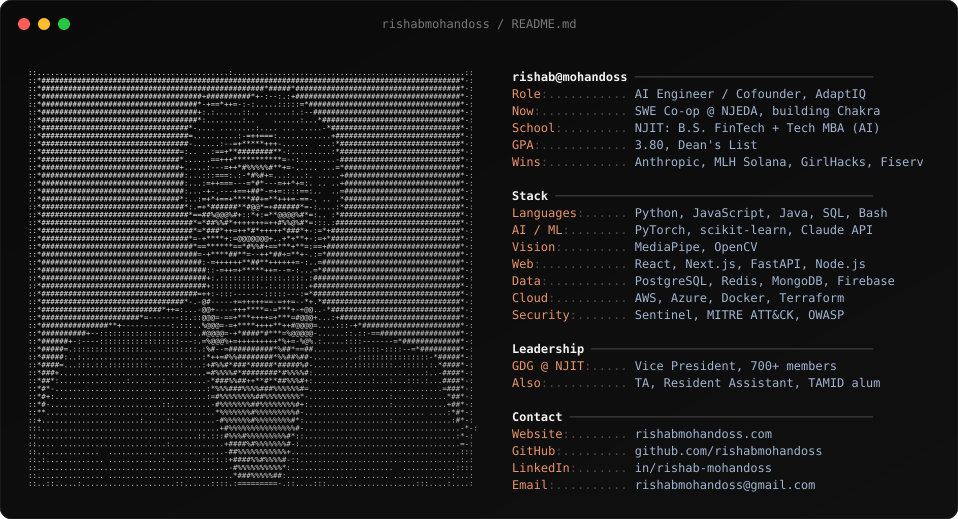

## Hi, I'm Rishab

I build AI that solves real problems. I'm a senior at NJIT (B.S. Financial Technology, concurrent Tech MBA in AI) and a cofounder of **AdaptIQ**, an interview-coaching platform for neurodivergent students that won the Anthropic Claude Builder Club Hackathon. Right now I'm a software engineering co-op at the **NJEDA**, building **Chakra**, an AI data-validation platform piloted with Fortune 500 companies. I sit between business and engineering on purpose, and I care most about access: tools that work for people standard software leaves out.

## Hackathon wins

| Win | Project |
|---|---|
| 1st place, Anthropic Claude Builder Club Hackathon | AdaptIQ |
| 1st place overall + MLH Solana track, NJIT GirlHacks | Alexandria |
| Winner, Fiserv / Rutgers Hack Day (3rd overall, Best Use of AI) | Empathy Engine |

## Featured work

| Project | What it does | Built with |
|---|---|---|
| **AdaptIQ** ([repo](https://github.com/rishabmohandoss/AdaptIQ---Rishab-)) | Mock interviews that read eye contact and voice in real time, then coach with Claude. 85% eye-contact detection, 96% transcription accuracy | React, Node.js, Claude API, MediaPipe, OpenCV, AWS (EC2, RDS, S3, VPC, IAM) |
| **Alexandria** ([repo](https://github.com/mayukha-arn/alexandria.work)) | Private AI search for company knowledge: clearance-scored access, local LLMs, and SHA-256 document hashes anchored on Solana so tampered sources are dropped before the model sees them | Next.js, TypeScript, FastAPI, Postgres, ChromaDB, Ollama, Rust (Anchor), Azure |
| **Chakra** | AI data validation for Fortune 500 pilots. Flags fabricated records in 200 ms at 95% accuracy on 250K test records | FastAPI, React, PostgreSQL, Docker, AWS, ML + LLM review |
| **Empathy Engine** | Chrome extension that detects hesitation in a call from vocal patterns and suggests how to reframe | Chrome MV3, WebSockets, Fastify, Gemini, Supabase pgvector |
| **Ometa\*N** ([repo](https://github.com/rishabmohandoss/code-efficiency-checker)) | Static scanner for insecure, inefficient AI-generated code. Covers the OWASP Top 10 with no AI backend. Presented at NJIT AI Exploration Day | JavaScript, React |
| **Virtual Home Lab** | Azure security lab: 3 VMs, segmented VNet, 5+ simulated attacks triaged and mapped to MITRE ATT&CK | Azure, Sentinel, Defender, Active Directory |
| **Order Matching & Risk Engine** | In-memory limit order book with risk checks and circuit breakers, tested on 10,000+ transactions | Python, WebSockets, Redis, Docker, Locust |
| **Ether** ([repo](https://github.com/rishabmohandoss/Moody)) | Two-person private space that talks through mood, music and shifting clouds | React, Firebase, Framer Motion |
| **Breathe** | Chrome extension that detects lost focus and walks you through a breathing exercise | MediaPipe, JavaScript |

More projects and games

- **[Hunger Games Newsvendor](https://github.com/rishabmohandoss/Hunger-Games)**: multiplayer classroom simulation with a live leaderboard, used in business analytics teaching
- **[SpyFall](https://github.com/rishabmohandoss/SpyFall)**: online social deduction game ([play](https://rishabmohandoss.github.io/SpyFall/))
- **[Tetris Pomodoro](https://github.com/rishabmohandoss/Tetris-Pomodoro-Timer)**: breaks earn you Tetris ([demo](https://rishabmohandoss.github.io/Tetris-Pomodoro-Timer/))
- **[WhatsApp ordering agent](https://github.com/rishabmohandoss/whatsapp-bot)**: messaging agents that cut manual intervention by 60%
- **AI Investment Analysis Engine**: NLP over 2M+ financial documents on an HPC cluster
- **Stock Trading Bot**, **Resume Customization Tool**, **Conversational Anki**

## Research

- **Enrollment yield prediction** with Dean Oya Tukel: ML on 12,000+ records over 15 years (Python, scikit-learn, pandas)
- **AI accessibility for neurodivergent users** with Prof. Andrew Klobucar: design research and prototyping that feeds AdaptIQ
- **Finternet**: white paper and video on decentralized financial infrastructure

## Find me

[Website](https://rishabmohandoss.com) · [LinkedIn](https://www.linkedin.com/in/rishab-mohandoss) · [Email](mailto:rishabmohandoss@gmail.com)
